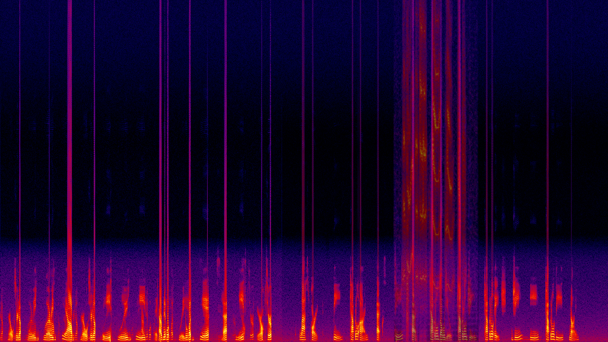
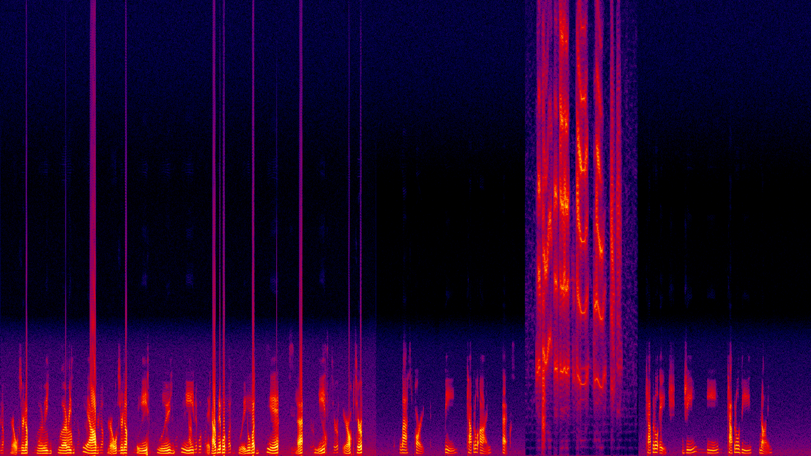

# CSAW Finals 2026: steg/youcanstealmystuff
## Context

This is a WAVE audio file which conceals a flag in three chunks.

```
look closely, and listen....
```

**Artifacts**

This challenge provides one file, `youcanstealmystuff.wav`, a RIFF/WAVE audio recording.

## Initial Analysis
I first wanted to see if any information about the flag could be found from the file’s metadata.

```
$ exiftool youcanstealmystuff.wav
'ExifTool Version Number         : 13.59
File Name                       : youcanstealmystuff.wav
Directory                       : .
File Size                       : 6.0 MB
File Modification Date/Time     : 2026:11:12 14:46:18-05:00
File Access Date/Time           : 2026:11:12 15:02:01-05:00
File Inode Change Date/Time     : 2026:11:12 19:22:59-05:00
File Permissions                : -rw-r--r--
File Type                       : WAV
File Type Extension             : wav
MIME Type                       : audio/x-wav
Encoding                        : Microsoft PCM
Num Channels                    : 2
Sample Rate                     : 44100
Avg Bytes Per Sec               : 176400
Bits Per Sample                 : 16
Date Created                    : Y0MgrX9swKRRfF8=
ID3 Size                        : 96
Comment                         : csaw{this_is_not_the_flag}
Genre                           : Country
Recording Time                  : Y0MgrX9swKRRfF8=
Date/Time Original              : Y0MgrX9swKRRfF8=
Duration                        : 0:00:34
```

Right away we see a decoy flag, which doesn’t help much but tells us we’re thinking on the right track. The other notable metadata is `Y0MgrX9swKRRfF8=`, which appears three times in fields which should hold dates and times. It also looks suspiciously like a Base64 encoding, but putting the string into CyberChef’s decoder yielded `cC ­lÀ¤Q|_`—gibberish for now.

Next, I decided to actually listen to the given audio, the second part of which clearly tells us, “last part: `bIxtsWGHgeV9`.” This too looks like Base64 but doesn’t decode to anything meaningful (`lŒm±a‡å}`).

[youcanstealmystuff.wav](./youcanstealmystuff.wav)

Well, that’s helpful! I also noted that the first half of the audio sounded backward, so I wanted to reverse it. I used an [online tool](https://audioalter.com/reverse), but there are also ways to do this from the command line. This gave me another portion of the flag: `csaw{but_y0u_`.

[rev-youcanstealmystuff.wav](./rev-youcanstealmystuff.wav)

## Remaining Analysis
I took a few important hints from the simple-to-recover parts of this challenge. First, the decoy flag in the metadata tells us the real flag will likely be of this same format, `csaw{flag}`, but what we are given as the end of that flag is not in that format. However, I saw that the Base64 decoding of this string ends in the closing bracket we’d expect. This led me to notice that the other string from the metadata had a character which decoded to an underscore, the character which separates words in the known portion of the flag.

Second, while listening to the audio, I heard a (rather unpleasant) high-pitched noise from about 0:23 to 0:26 only in the right audio channel. I thought it might be a frequency-modded clue, which a spectrogram confirmed. Here’s the spectrogram for the original audio:



And just for the right audio channel:



With this finding, I isolated the right track for this clip, pitched it down, and slowed it using the `pedalboard` Python library. This was mostly trial and error until I got a somewhat intelligible audio.

[hidden_57.wav](./hidden_57.wav)

I worked out that this audio was saying “the key is almost \<something\>” and gave my best guess that “there” was the second word I couldn’t understand. Trying a few times to make sense of the encoded portions, I found that decoding a Vigenère cipher and Base64 in sequence turned `bIxtsWGHgeV9` into `my_h3@rt}`. Vigenère makes sense as a cipher choice since it skips nonalphabetic characters, leaving the Base64 special characters as they were in the original encoded string.

I used this working decoding to also recover the middle portion of the flag from `Y0MgrX9swKRRfF8=` into `c@nt_st3@l_`, which can be reproduced by my [solve script](https://github.com/egkushelevsky/egkushelevsky-writeups/blob/main/csaw2026/steg/you_can_steal_my_stuff/solve.py). With these pieces we recover the whole flag, `csaw{but_y0u_c@nt_st3@l_my_h3@rt}`—a fitting flag for a challenge of the “country” genre.

## Credits
Written by [Elizabeth Kushelevsky](https://egkushelevsky.xyz). Challenge by `Arcana` for CSAW CTF Finals 2026.